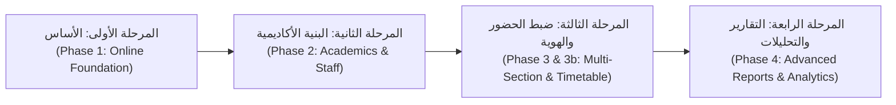

# الملخص التنفيذي — التحليل الفني والهندسي الشامل
## Attendance Recording System (نظام تسجيل الحضور الذكي)

---

### 1. بطاقة تعريف المشروع

| البند | البيان التفصيلي |
|---|---|
| **اسم المشروع** | نظام تسجيل الحضور الذكي بالباركود وQR (Attendance Recording System) |
| **الجهة المستفيدة** | كلية البوليتكنك — قسم تقنيات المختبرات الطبية (Medical Laboratory Technology - MLT) |
| **طبيعة النظام** | تطبيق ويب مؤسسي متكامل لإدارة المحاضرات الأكاديمية، وتسجيل الحضور ومسح بطاقات الطلاب بتقنية QR المشفر، ورصد الغيابات وتتبع مؤشرات الالتزام والحرمان الأكاديمي. |
| **هندسة النظام (Architecture)** | Monorepo متكامل عبر `pnpm workspaces` يضم واجهة أمامية حديثة وخلفية قوية: |
| | - **Frontend**: Next.js 14 (App Router) + React 18 + TypeScript + Tailwind CSS |
| | - **Backend**: NestJS 10 + Node.js (TypeScript) + Socket.IO + Express |
| | - **Database & ORM**: PostgreSQL (بإصدار محلي وحسابات إنتاج سحابية) + Prisma ORM 6.1 |
| **الفرع البرمجي الحالي** | `online-foundation` (تعديلات working tree محلية تشمل المرحلتين الثانية والثالثة وتوسعة التقارير المتقدمة) |
| **نوع التدقيق** | تدقيق فني وهندسي ووظيفي كامل للقراءة فقط (Read-Only Complete Audit) دون تعديل أو مساس بقواعد البيانات أو الكود. |

---

### 2. الهدف الاستراتيجي للنظام

أُنشئ هذا النظام لمعالجة المشاكل التقليدية في تسجيل حضور وغياب الطلاب داخل الجامعات والكليات الأكاديمية:
1. **القضاء التام على تسجيل الحضور الوهمي أو الإنابة**: حيث يحمل كل طالب بطاقة جامعية مزودة برمز QR مشفر ومربوط بسجل قيد فريد في قاعدة البيانات.
2. **السرعة الفائقة في قاعات المحاضرات والمختبرات**: يتمكن الأستاذ أو الفني من مسح بطاقات عشرات الطلاب في ثوانٍ معدودة عبر كاميرا الهاتف أو اللابتوب أو قارئ الباركود، مع تغذية صوتية وبصرية فورية.
3. **الدقة المتناهية والعدالة الأكاديمية**:
   - منع التسجيل العشوائي عبر عزل الشعب والمراحل وفترات الدراسة (صباحي/مسائي).
   - حل معضلة الحضور المتبادل بين الشعب للمادة نفسها من خلال نظام **الجدول الدراسي الأسبوعي (Timetable)** وميزة **"حاضر عبر الشعبة"**.
   - إغلاق المحاضرة ذرياً (Atomically) واحتساب الغياب تلقائياً للطلبة غير الحاضرين دون إمكانية التلاعب اليدوي اللاحق.
4. **أتمتة المتابعة والإنذارات الأكاديمية**: حساب نسب الغياب تلقائياً فور إغلاق المحاضرة، وتصنيف الطلبة حسب مراحل الإنذار (أول، ثانٍ، نهائي/حرمان).

---

### 3. ملخص مراحل تطور المشروع (Phases Overview)

مر المشروع بأربع مراحل تطويرية رئيسية حتى حالته الحالية:

1. **Phase 1 — الأساس والتحول إلى السحاب (Online Foundation & Staff Auth)**:
   - الانتقال من SQLite المحلي القديم إلى PostgreSQL مع ترحيلات Prisma (Migrations 0001–0003).
   - بناء نظام الصلاحيات الموحد (RBAC) القائم على الجلسات المؤمنة المشفرة (`StaffSession`) ورفض الصلاحيات افتراضياً (Deny-by-default).
   - توفير نظام حماية الهجمات والتخمين (Rate Limiting) وتدقيق العمليات (`AuditLog`).
2. **Phase 2 — الهيكلية الأكاديمية وإدارة الكادر (Academic Structure)**:
   - إضافة المراحل الأكاديمية الأربع (المرحلة 1، 2، 3، 4) ونوع الدراسة (صباحي/مسائي) وتوليد أرقام الطلاب المستقلة مثل (`S2-1001`).
   - ربط التدريسيين بالمواد الأكاديمية (`Course`) عبر جدول التعيينات التدريسية (`TeachingAssignment`) دون حصرهم في شعبة واحدة مسبقاً.
   - إنشاء صفحة المتابعة المقيدة بنطاق المادة (`/followup`) لمنع تسرب بيانات مواد أخرى.
3. **Phase 3 & 3b — سلامة مسار الحضور والمحاضرات متعددة الشعب والجدول الدراسي**:
   - التخلص من ثغرة الأسماء المكررة باعتماد `studentId` كمعرف فريد حصري لسجلات الحضور في `AttendanceRecord` عبر Migration 0005.
   - ربط المحاضرات بالمفتاح الأجنبي المباشر `sectionId` عبر Migration 0006، ثم دعم المحاضرات المشتركة لأكثر من شعبة معاً عبر جدول `LectureSection` في Migration 0007.
   - بناء جدول المحاضرات الأسبوعي (`TimetableEntry`) لتمكين قاعدة الحضور المتبادل المشروع ("حاضر عبر الشعبة") خلال الأسبوع التقويمي ISO، مع وسم السجل بملاحظة منعاً للازدواجية.
   - تأمين الإغلاق الذري عبر القفل الاستشاري `pg_advisory_xact_lock` ومنع التعديل على المحاضرات المغلقة بصورة قطعية.
4. **Phase 4 — منظومة التقارير المتقدمة والتحليلات (Reports & Analytics)**:
   - استحداث وحدة التقارير الكاملة (`ReportsModule` في الخلفية وصفحة `/reports` في الواجهة).
   - تقديم 6 تبويبات تحليلية شاملة: لوحة المؤشرات المركزية، تقرير الطلاب، رادار الغائبين والإنذارات، تحليل المواد، تقييم المحاضرين، وإحصائيات الشعب والمراحل.
   - محرك فلترة متزامن مع تصدير مرن لتقارير PDF والطباعة وجداول البيانات Excel.

---

### 4. الإحصائيات العامة لتدقيق المشروع

تم إجراء فحص شامل وكامل لقاعدة الكود (Codebase) أسفر عن الأرقام الحقيقية التالية:

| المقياس | القيمة المحققة |
|---|---|
| **إجمالي الملفات المفحوصة والمصنفة** | **163 ملفاً** (تغطي Backend, Frontend, Migrations, Tests, Scripts, Configs) |
| **إجمالي أسطر كود الـ Backend** | **~11,200 سطر** من TypeScript الصافي |
| **إجمالي أسطر كود الـ Frontend** | **~13,400 سطر** من TSX / CSS / Tailwind |
| **عدد صفحات الواجهة (Routes)** | **10 مسارات كاملة** في Next.js App Router |
| **عدد عناصر الواجهة والأزرار المفحوصة تفصيلياً** | **148 عنصراً تفاعلياً** (أزرار، حقول، فلاتر، تبويبات، نوافذ منبثقة) |
| **عدد مسارات الـ API (Endpoints)** | **46 مساراً** محمياً بنظام الصلاحيات والجلسات |
| **أحداث الـ WebSocket (Socket.IO)** | **6 أحداث حية** متزامنة |
| **عدد جداول قاعدة البيانات (Prisma Models)** | **13 نموذجاً (Models)** متصلة بعلاقات وثيقة |
| **عدد ترحيلات قاعدة البيانات (Migrations)** | **7 ترحيلات رسمية** (من 0001 إلى 0007) |
| **إجمالي اختبارات النظام المؤتمتة** | **128 اختباراً مؤتمتاً** (120 Backend + 8 Frontend) بنسبة نجاح 100% في البيئة المعزولة |

---

### 5. أبرز النتائج والتقييم الهندسي

#### نقاط القوة البارزة (Strengths):
1. **تصميم أمني استثنائي في المصادقة والتخويل**:
   - لا يتم تخزين أي رمز جلسة بنصه الصريح؛ يُستخدم تجزئة `SHA-256` للجلسات المحفوظة في كوكيز `HttpOnly; SameSite=Lax`.
   - التخويل مبني على استراتيجية الرفض الافتراضي (Deny-by-default)، حيث تفحص الحراس (`AuthGuard`, `PermissionsGuard`) كل مسار وتلزم بوجود صلاحيات محددة بدقة.
   - حماية فعالة من هجمات التوقيت (Timing Attacks) على كلمات المرور باستخدام تجزئة وهمية للمعرفات المجهولة (`DUMMY_HASH`).
   - حماية متوازنة من هجمات التخمين (Rate Limiting) تفصل بين عنوان IP وحساب الموظف، مما يحمي الكليات المشتركة خلف شبكة NAT واحدة.
2. **سلامة بيانات الحضور والتزامن (Data Concurrency & Integrity)**:
   - استخدام أقفال PostgreSQL الاستشارية داخل المعاملات الذرية `pg_advisory_xact_lock(hashtext(lectureId))` يمنع أي تسابق بين عمليات المسح والإغلاق.
   - منع تسجيل الطالب مرتين عبر قيد فريد قطعي في قاعدة البيانات `@@unique([lectureId, studentId])`.
   - قفل المحاضرات المغلقة بحيث يستحيل برمجياً عبر الـ API تعديل أو حذف أو تبديل حالة أي سجل بعد انتهاء الجلسة، مع تسجيل أي محاولة في جدول التدقيق `AuditLog`.
   - استبعاد المحاضرات المفتوحة والمؤرشفة تلقائياً من احتساب إحصائيات الحضور والغياب، مما يوحد الأرقام تماماً عبر جميع شاشات النظام.
3. **نظام مرن للحضور التبادلي عبر الشعب**:
   - حل عملي مبتكر لمشكلة حضور الطالب مع شعبة أخرى من خلال جدول المواعيد الأسبوعي، مما يسجل الطالب كـ "حاضر بملاحظة" ويمنع احتساب غياب جائر عليه في شعبته الأصلية، دون تضخيم عدد المحاضرات الفيزيائية.
4. **تجربة مستخدم عربية بالكامل ومتجاوبة (RTL & Responsive)**:
   - الواجهة تدعم اللغة العربية بالكامل واتجاه القراءة والكتابة من اليمين لليسار.
   - رسائل أخطاء واضحة ومترجمة لكل حالات تعطل الكاميرا ومسح QR.

#### نقاط الضعف والمخاطر المكتشفة التي تحتاج معالجة (Key Audit Findings):
1. **عملية تصفير الغيابات (`resetAbsences`) لا تستثني المحاضرات المفتوحة (High Risk)**:
   - عند تنفيذ تصفير الغياب لمرحلة ما، ينفذ الكود `deleteMany` على سجلات الحضور للطلاب المطابقين دون شرط `lecture: { status: 'CLOSED' }`. فإذا كانت هناك محاضرة نشطة حالياً أثناء التصفير، قد تُحذف سجلات حضورها أو غيابها.
2. **اختلاف تطبيق الـ Migrations بين الإنتاج والتطوير (Critical Architecture Drift)**:
   - قاعدة الإنتاج الحالية (Production) ما تزال تقف عند الترحيل `0003_staff_management`.
   - الترحيلات `0004` (الأكاديميات)، `0005` (هوية الحضور وأرشفة المحاضرات)، `0006` (ربط المحاضرة بالشعبة FK)، و `0007` (المحاضرات المتعددة والجدول) مطبقة فقط في بيئة التطوير المحلية ومختبرة في قواعد الاختبار المؤقتة.
   - **القرار الحاسم**: يجب عدم تطبيق أي ترحيل على الإنتاج دفعة واحدة دون إجراء نسخ احتياطي شامل وتنفيذ خطة نشر متدرجة في نافذة صيانة رسمية.
3. **توليد بطاقات الطلاب يستند إلى معرّف ثابت (Opaque ID) دون تاريخ انتهاء**:
   - رمز الـ QR للطالب في جدول `StudentQrToken` لا يحمل حقلاً لانتهاء الصلاحية (`expiresAt`)، بل يعتمد على الإلغاء اليدوي فقط (`revokedAt`). في حال تسرب صورة بطاقة الطالب، يمكن استخدامها دائماً ما لم يتم إلغاؤها يدوياً وإصدار بطاقة جديدة.
4. **تخزين محاولات الدخول الفاشلة داخل الذاكرة (In-Memory Map)**:
   - آلية Rate Limiting تعتمد على `Map<string, AttemptBucket>` داخل خادم NestJS؛ وبالتالي فإن إعادة تشغيل الخادم تصفر العدادات، كما أنها لا تدعم بيئات التوسع الأفقي (Multi-instance clustering) دون استخدام Redis.

---

### 6. القرار النهائي للجاهزية (Readiness Verdict)

> [!IMPORTANT]
> **التقييم العام للجاهزية: NO-GO للإنتاج المباشر في اللحظة الحالية / GO مشروط بعد نافذة الصيانة الرسمية.**
> الكود البرمجي الحالي مستقر للغاية ومكتمل هندسياً وتجاوز 128 اختباراً دقيقاً، لكن لا يمكن إطلاقه على الإنتاج فوراً لأن قاعدة الإنتاج ما تزال على Migration 0003 وتفتقر إلى أعمدة المراحل والمواد والجدول وهوية الطلاب الجديدة. التطبيق يتطلب نافذة صيانة معتمدة لترحيل البيانات وتطبيق Migrations 0004 إلى 0007 بالتتابع.

