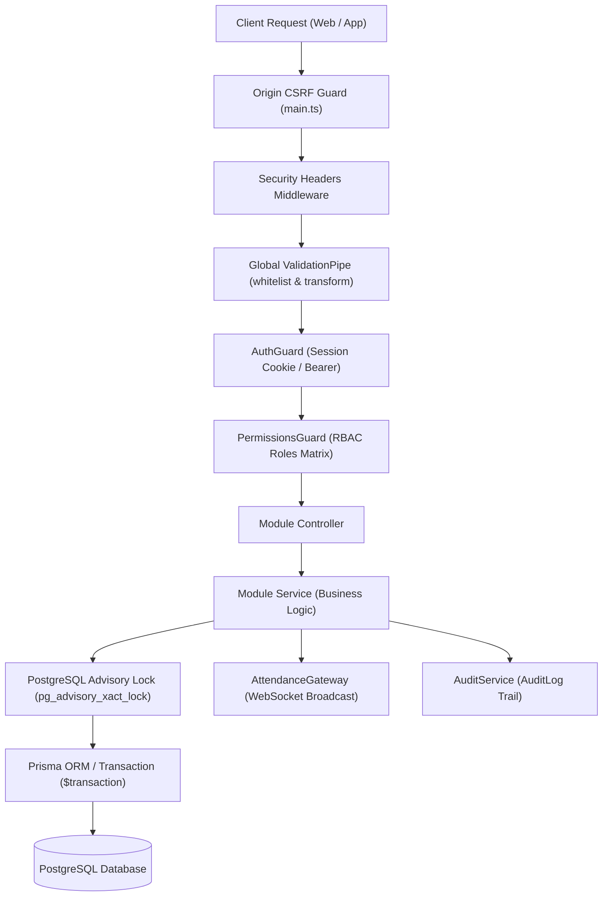

# التحليل الهندسي الشامل للواجهة الخلفية (Backend Architecture & Modules)
## Attendance Recording System — NestJS + Prisma + PostgreSQL

---

### 1. المخطط العام ومعمارية الخادم (Server Architecture)

تم بناء الواجهة الخلفية على إطار عمل **NestJS 10** بنمط **Modular Architecture** المنظم. يعمل الخادم وفق مبدأ **الأمان بالرفض الافتراضي (Deny-by-default)**، حيث تخضع كافة الطلبات لحراس التحقق من الهوية والصلاحيات قبل وصولها إلى وحدات التحكم (Controllers) أو الخدمات (Services).

---

### 2. تدفق معالجة الطلب العام (Global Request Pipeline)

عند وصول أي طلب HTTP إلى الخادم (المنفذ 3001 أو المنفذ السحابي)، يمر عبر المحطات الإلزامية التالية بتسلسل صارم:

1. **تحقق مصدر الطلب ومكافحة التزوير (Origin Validation & CSRF Defense)** في `main.ts`:
   - يتم فحص ترويسة `Origin`. إذا كان الطلب من نوع يغير الحالة (`POST`, `PUT`, `PATCH`, `DELETE`) ومصدره غير موجود في قائمة المصادر المعتمدة (`getAllowedOrigins()`)، يُرفض الطلب فوراً برمز `403 Forbidden` برسالة (`Origin غير مسموح به`).
2. **ترويسات الأمان الصارمة (Security Headers Middleware)**:
   - حقن ترويسات أمان تمنع الاختراق: `X-Content-Type-Options: nosniff`، `X-Frame-Options: DENY` (لمنع تضمين النظام في iframes خبيثة)، `Referrer-Policy: no-referrer`، و `Permissions-Policy: camera=(self), microphone=()`.
3. **فلترة وتحويل البيانات (Global ValidationPipe)**:
   - ضبط الإعدادات: `whitelist: true` (تجاهل أي حقل إضافي غير مصرح به في DTO)، و `forbidNonWhitelisted: true` (رفض الطلب بالكامل برمز 400 إذا احتوى على حقول غريبة غير معرّفة)، مع `transform: true` للتحويل التلقائي لأنواع البيانات.
4. **حارس المصادقة العام (Global AuthGuard)**:
   - يفحص وجود مزخرف `@Public()`. إذا لم يتوفر، يستخرج رمز الجلسة من كوكيز `attendance_session` أو ترويسة `Authorization: Bearer <token>`.
   - يقوم بحل الجلسة بالبحث عن تجزئة `SHA-256` للرمز في جدول `StaffSession`. إذا كانت منتهية الصلاحية أو ملغاة (`revokedAt != null`)، يُرفض الطلب بـ `401 Unauthorized`.
   - يُحقن كائن المستخدم المصادق عليه `AuthenticatedUser` في كائن الطلب `req.user`.
5. **حارس الصلاحيات العام (Global PermissionsGuard)**:
   - يقرأ الصلاحيات المطلوبة المحددة بواسطة مزخرف `@RequirePermissions(...)`.
   - يطابق صلاحيات دور المستخدم مع الصلاحيات المطلوبة وفق مصفوفة `ROLE_PERMISSIONS`. إذا نقصت صلاحية واحدة، يُرفض الطلب بـ `403 Forbidden`.

---

### 3. التحليل الفردي لوحدات النظام (Modules Deep-Dive)

يحتوي الخادم على **13 وحدة برمجية (Modules)** متكاملة:

#### 3.1 وحدة المصادقة والجلسات (`AuthModule`)
- **الملفات**:
  - `auth.controller.ts`: يوفر نقاط الدخول `/api/auth/login` (عامة `@Public()`)، `/api/auth/logout`، `/api/auth/me`، و `/api/auth/refresh`.
  - `auth.service.ts`: المحرك الأمني لإدارة الجلسات وكلمات المرور والحد من محاولات التخمين.
  - `authorization.service.ts`: خدمة مركزية تحسب النطاق الأكاديمي المسموح به للمستخدم (المواد المسندة، المراحل، المحاضرات).
  - `dto/login.dto.ts`: نموذج بيانات تسجيل الدخول (`staffId`, `password`).
- **آلية العمل الدقيقة**:
  - **الحد من التخمين (Rate Limiting)**: يفصل بين عنوان الـ IP والحساب (`acct:staffId:ip`). محاولات الدخول الناجحة لا تستهلك رصيد المحاولات الفاشلة، وتسمح بـ 200 محاولة فاشلة لعنوان الـ IP الكلي (لمنع قفل الكلية خلف NAT) و10 محاولات فاشلة للحساب الواحد، مع قفل الحساب 15 دقيقة بعد 5 محاولات متتالية خاطئة.
  - **مقاومة هجمات التوقيت (Timing Attacks)**: في حال إدخال اسم مستخدم غير موجود، ينفذ الخادم عملية فحص تجزئة وهمية `verifyPassword(password, DUMMY_HASH)` لتستغرق الاستجابة نفس الوقت تماماً كالحساب الموجود.
  - **الجلسات**: يتم توليد رمز عشوائي آمن بطول 32 بايت مشفر بـ `base64url`. يُخزن تجزئته `SHA-256` في قاعدة البيانات، ويرسل الرمز الأصلي للعميل في كوكي `HttpOnly; SameSite=Lax; Path=/` لمنع سرقته عبر ثغرات XSS.

#### 3.2 وحدة إدارة المحاضرات (`LectureModule`)
- **الملفات**:
  - `lecture.controller.ts`: مسارات إنشاء المحاضرة، جلب المحاضرة الحالية، إغلاق المحاضرة، أرشفتها، والتحقق من صلاحية رمز الـ QR.
  - `lecture.service.ts`: عقل إدارة المحاضرة ودورة حياتها وتدوير رموز الـ QR وإغلاق المحاضرة ذرياً.
  - `attendance.gateway.ts`: بوابة الـ WebSocket لبث أحداث مسح الحضور وتدوير الرمز وتحديث الإحصائيات لغرفة المحاضرة.
  - `dto/create-lecture.dto.ts` و `dto/validate-qr.dto.ts`.
- **العمليات والخصائص الحرجة**:
  - **حارس المحاضرة النشطة الواحدة**: يمنع النظام المحاضر من فتح أكثر من محاضرة نشطة في نفس الوقت (`conductedByUserId == actor.id`).
  - **دعم المحاضرات متعددة الشعب (Multi-Section)**: يمكن للمحاضرة استهداف شعبة واحدة أو عدة شعب معاً، وتُربط عبر جدول `LectureSection`.
  - **تدوير رمز الـ QR التلقائي**: يدور رمز المحاضرة كل 22 ثانية (`QR_ROTATION_MS`) بصلاحية تنتهي بعد 25 ثانية (`QR_TTL_MS`). مرجع الصلاحية الوحيد والنهائي هو حقل `qrExpiresAt` في قاعدة البيانات. لا توجد ذاكرة كاش مؤقتة تبقي الرموز القديمة صالحة.
  - **الإغلاق الذري واحتساب الغياب (Atomic Close)**:
    - يأخذ الخادم قفلاً استشارياً حصرياً للمحاضرة `SELECT pg_advisory_xact_lock(hashtext(id))`.
    - يغير حالة المحاضرة من `ACTIVE` إلى `CLOSED`. أي محاولة إغلاق ثانية أو مسح متزامن ترفض فوراً.
    - يستخرج قائمة طلاب الشعب المحددة حصراً (دون أي توسع لبقية المرحلة). إذا كانت الشعبة فارغة تكون النتيجة 0 طالب و0 غياب.
    - يتحقق من قاعدة "حاضر عبر الشعبة": إذا كان الطالب غائباً في هذه المحاضرة ولكنه حضر محاضرة أخرى لنفس المادة في نفس الأسبوع التقويمي ISO، وكانت مادته مجدولة في الجدول الدراسي، يُسجل تلقائياً كـ `PRESENT` بملاحظة (`حاضر عبر الشعبة X`)، ويسجل غير الحاضرين كـ `ABSENT`.
    - يعيد احتساب إحصائيات الطلاب عبر `recomputeStudentStats`.

#### 3.3 وحدة تسجيل الحضور ومسح البطاقات (`AttendanceModule`)
- **الملفات**:
  - `attendance.controller.ts`: مسارات مسح بطاقة الطالب `/scan`، جلب كشف الحضور، تبديل الحالة `/toggle-status`، والإضافة اليدوية `/manual`.
  - `attendance.service.ts`: معالجة المسح الميداني، التحقق من انتماء الطالب للشعبة، منع التكرار، والقفل النهائي للمحاضرات المغلقة.
  - `dto/scan-student.dto.ts` و `dto/add-manual-attendance.dto.ts`.
- **الخصائص والضمانات الأمنية**:
  - **منع التعديل على المحاضرات المغلقة**: تطبق دالة `assertLectureWritable` فحصاً حاسماً على حالة المحاضرة؛ فإذا كانت `CLOSED` أو مؤرشفة، تُرفض أي عملية مسح أو تعديل أو إضافة يدوية فوراً برمز 400 وتُسجل محاولة مرفوضة في `AuditLog` بعنوان `ATTENDANCE_WRITE_REJECTED`.
  - **التحقق من بطاقة الـ QR**: يتم التحقق عبر رمز البطاقة الفريد في جدول `StudentQrToken`. الرموز الملغاة (`revokedAt != null`) أو غير المعرّفة تُرفض قطعياً.
  - **التحقق من الشعبة والمرحلة**: يطابق الكود مرحلة ودراسة وشعبة الطالب مع المحاضرة؛ وإذا كان الطالب من شعبة موازية، يتحقق من وجود قيد له في جدول المواعيد `TimetableEntry` لنفس المادة ليُقبل مع وسم السجل بملاحظة.
  - **منع التكرار المتزامن**: يعتمد الكود على القيد الفريد `@@unique([lectureId, studentId])` في قاعدة البيانات مع معالجة خطأ `P2002` لإرجاع استجابة ودية تفيد بأن الطالب مسجل مسبقاً (`alreadyRegistered: true`) دون حدوث استثناء خادم.

#### 3.4 وحدة إدارة الطلاب والبطاقات (`StudentModule`)
- **الملفات**:
  - `student.controller.ts`: مسارات إدارة الطلاب الفردية والجماعية واستيراد ملفات الإكسل وتصفير الغيابات وإصدار بطاقات الـ QR.
  - `student.service.ts`: العمليات الحسابية للأرصدة والإحصائيات، فك تشفير وتوليد بطاقات QR، تصفير السجلات، والتحقق من النطاق.
  - `dto/`: تضم 5 نماذج بيانات (`create-student.dto.ts`, `update-student.dto.ts`, `import-students.dto.ts`, `batch-students.dto.ts`, `reset-absences.dto.ts`).
- **الملاحظات الهندسية**:
  - **توليد الكود الأكاديمي**: يتم ترقيم كود الطالب تلقائياً ببادئة المرحلة (مثلاً `S2-1001` للمرحلة الثانية).
  - **استيراد الطلاب**: معالجة دفعية (Batch Processing) داخل معاملة Prisma مع التحقق المسبق من تكرار الأرقام والأسماء وحل الشعبة.
  - **تصفير الغيابات (`resetAbsences`)**: يتطلب تحديد المرحلة (`stage`) إجبارياً لمنع التصفير العابر للمراحل، ويدعم التصفير الكامل أو تصفير الغيابات فقط داخل معاملة ذرية مع إعادة احتساب الإحصائيات وتوثيق العملية في التدقيق.

#### 3.5 وحدة إدارة الشعب الأكاديمية (`SectionModule`)
- **الملفات**: `section.controller.ts`, `section.service.ts`, `dto/create-section.dto.ts`, `dto/update-section.dto.ts`.
- **الوظيفة**: إدارة شعب الأقسام مقيدة بالمرحلة ونوع الدراسة (`stage`, `studyPeriod`, `name`).
- **الحماية**: تمنع حذف شعبة مرتبطة بمحاضرات أو طلاب منعاً لكسر العلاقات، وتزامن التعديلات بدقة.

#### 3.6 وحدة إدارة المواد الدراسية (`CourseModule`)
- **الملفات**: `course.controller.ts`, `course.service.ts`, `dto/create-course.dto.ts`, `dto/update-course.dto.ts`.
- **الوظيفة**: إدارة المواد الدراسية وربط كل مادة بمرحلتها الأكاديمية ورمزها الفريد (`stage`, `code`).

#### 3.7 وحدة تعيينات التدريسيين (`AssignmentModule`)
- **الملفات**: `assignment.controller.ts`, `assignment.service.ts`, `dto/create-assignment.dto.ts`.
- **الوظيفة**: إسناد المواد للتدريسيين والفنيين عبر جدول `TeachingAssignment(staffUserId, courseId)`. التعيين يتم على مستوى **المادة بالكامل**، ويختار التدريسي الشعبة عند إنشاء كل محاضرة.

#### 3.8 وحدة متابعة غيابات الطلاب (`FollowupModule`)
- **الملفات**: `followup.controller.ts`, `followup.service.ts`.
- **الوظيفة**: توفير استعلامات دقيقة ومقيدة لنِسب حضور وغياب الطلاب لكل مادة أكاديمية.
- **الأمان وعزل البيانات (IDOR Protection)**: التدريسي لا يمكنه عرض طلاب مادة غير مسندة إليه؛ وإذا حاول طلب طالب في مسار `/followup/:studentId` خارج نطاق مرحلته ومواده، يُرجع النظام `404 Not Found` دون كشف ما إذا كان الطالب موجوداً في الكلية أم لا.

#### 3.9 وحدة الجدول الدراسي الأسبوعي (`TimetableModule`)
- **الملفات**: `timetable.controller.ts`, `timetable.service.ts`, `dto/create-timetable-entry.dto.ts`, `dto/update-timetable-entry.dto.ts`.
- **الوظيفة**: جدول المواعيد الأسبوعي للشعب والمواد (أيام الأسبوع من 0=الأحد إلى 6=السبت، والتوقيت بنمط "HH:mm").
- **القواعد الصارمة**: يمنع تعارض المواعيد للشعبة في نفس اليوم، ويمنع إدخال وقت انتهاء قبل وقت البدء، ويتحكم في أحقية الحضور المتبادل بين الشعب المتوازية.

#### 3.10 وحدة التقارير المتقدمة والتحليلات (`ReportsModule`)
- **الملفات**: `reports.controller.ts`, `reports.service.ts`, `report-types.ts`.
- **الوظيفة**: توليد الإحصائيات الكلية للكلية، وتحديد الطلبة المهددين بالإنذار والرسوب بنسب دقيقة، وتحليل أداء التدريسيين، واحتساب نسب الحضور لجميع المراحل والشعب.
- **القواعد الحسابية**: تستبعد المحاضرات النشطة والمحاضرات المؤرشفة تماماً من الحسابات، وتستبعد سجلات "حاضر عبر الشعبة" من تضخيم عدد الحضور الفيزيائي للمادة.

#### 3.11 وحدة إدارة الكادر والمستخدمين (`StaffModule`)
- **الملفات**: `staff.controller.ts`, `staff.service.ts`, `dto/create-staff.dto.ts`, `dto/update-staff.dto.ts`, `dto/update-staff-status.dto.ts`, `dto/reset-staff-password.dto.ts`.
- **الوظيفة**: إدارة حسابات أعضاء هيئة التدريس والفنيين والمسجل ورئيس القسم.
- **الحماية الهندسية**:
  - لا يمكن للمسجل إنشاء أو تعديل حساب رئيس قسم أو مسجل آخر (منع تصعيد الصلاحيات Privilege Escalation).
  - حماية حساب رئيس القسم الأخير النشط من التعطيل أو الحذف لضمان عدم قفل النظام.
  - حساب المالك `SYSTEM_OWNER` حساب تجريبي أولي محمي لا يمكن تعديله أو حذفه عبر واجهات الـ API.

#### 3.12 وحدة سجل التدقيق والمراقبة (`AuditModule`)
- **الملفات**: `audit.module.ts`, `audit.service.ts`.
- **الوظيفة**: تسجيل كافة الأحداث الحساسة في جدول `AuditLog` (تسجيل الدخول، إنشاء المحاضرات، إغلاق المحاضرات، أرشفة المحاضرات، تصفير الغيابات، التعديلات المرفوضة، وتغيير الحسابات) مع توثيق معرف الموظف، نوع الحدث، عنوان IP، والتاريخ والوقت بدقة.

#### 3.13 وحدة التهيئة الأولية (`SetupModule`)
- **الملفات**: `setup.module.ts`, `initial-setup.service.ts`.
- **الوظيفة**: فحص وتهيئة النظام في التشغيل الأول وتوليد حساب المالك المؤقت وإعدادات النظام الأساسية.

