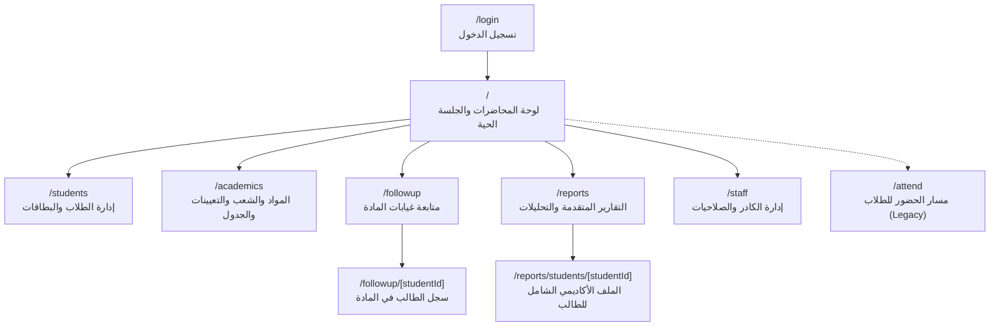

# التحليل الشامل لصفحات الواجهة الأمامية (Frontend Pages & Routing)
## Attendance Recording System — Next.js 14 App Router

---

### 1. خريطة مسارات التطبيق (Application Routing Map)

يعتمد التطبيق على نظام التوجيه الحديث **Next.js 14 App Router** مع دعم كامل للغة العربية (RTL)، والمكونات التفاعلية، والتصميم المتجاوب لجميع الشاشات.

---

### 2. تحليل صفحات النظام صفحةً بصفحة (Page-by-Page Audit)

#### 2.1 صفحة لوحة المحاضرات والجلسة الحية (`/`)
- **مسار الملف**: `apps/web/src/app/page.tsx`
- **الغرض الوظيفي**: الشاشة الرئيسية لعمل التدريسيين والفنيين أثناء الدوام؛ تتيح إنشاء محاضرة جديدة، عرض رمز الـ QR المتغير على شاشة القاعة، مسح بطاقات الطلاب بكاميرا الجهاز مباشرة، استعراض كشف الحاضرين والغائبين المباشر، والإنهاء الذري للمحاضرة.
- **الأدوار المصرح لها**: كافة الأدوار المسجلة (`HEAD_OF_DEPARTMENT`, `REGISTRAR`, `LECTURER`, `TECHNICAL_LECTURER`, `SYSTEM_OWNER`).
- **المكونات المستهلكة**: `CameraScanner.tsx`, `Navbar.tsx`, `RequireAuth.tsx`, أيقونات `lucide-react`.
- **مصادر البيانات والـ API**:
  - `GET /api/lectures/active`: جلب المحاضرة المفتوحة للمستخدم الحالي إن وجدت.
  - `GET /api/courses`: جلب قائمة المواد المسندة للمحاضر لاختيار مادة المحاضرة.
  - `GET /api/sections`: جلب قائمة شعب المرحلة المحددة.
  - `POST /api/lectures`: إنشاء محاضرة جديدة (تتطلب `courseId` و `sectionIds`).
  - `POST /api/attendance/scan`: إرسال رمز بطاقة الطالب الممسوح بالكاميرا لتسجيل حضوره.
  - `POST /api/attendance/toggle-status`: تبديل حالة الطالب يدوياً (متاح أثناء المحاضرة النشطة فقط).
  - `POST /api/attendance/manual`: إضافة طالب يدوياً بالاسم أو الكود.
  - `POST /api/lectures/:id/close`: إغلاق المحاضرة ذرياً واحتساب الغيابات.
  - `GET /api/lectures`: استعراض سجل المحاضرات السابقة.
  - `DELETE /api/lectures/:id`: أرشفة محاضرة (للمسؤولين فقط).
- **قناة الاتصال الحي (Real-time)**:
  - تتصل عبر `socket.io-client` بغرفة المحاضرة `lecture:${id}` لاستقبال أحداث:
    - `qr_refreshed`: تحديث رمز الـ QR المعروض كل 22 ثانية فورياً.
    - `attendance_recorded`: إضافة الطالب لقائمة الحاضرين مع تشغيل نغمة النجاح الصوتية.
    - `stats_updated`: تحديث عدادات الحاضرين والغائبين مباشرة.
- **حالات العرض (UI States)**:
  - **حالة عدم وجود محاضرة نشطة**: تظهر لوحة إنشاء محاضرة مع منتقي المادة، الشعب المتعددة، ونوع الدراسة، مع جدول بأحدث المحاضرات المغلقة.
  - **حالة وجود محاضرة نشطة**: تنقسم الشاشة إلى قسمين: رمز QR كبير ومتجدد، وقارئ الكاميرا مع كشف الطلاب المفرز فورياً (حاضرون/غائبون) وزر إنهاء المحاضرة المميز باللون الأحمر.
  - **حالة التحميل والخطأ**: مؤشرات تحميل ناعمة ورسائل تنبيه عربية منبثقة واضحة عند تكرار المسح أو رفض الطالب.

#### 2.2 صفحة تسجيل الدخول (`/login`)
- **مسار الملف**: `apps/web/src/app/login/page.tsx`
- **الغرض الوظيفي**: استيثاق هوية أعضاء الكادر الإداري والتدريسي عبر الرقم الوظيفي وكلمة المرور.
- **الأدوار المصرح لها**: متاحة للعموم (`@Public()`). إذا كان المستخدم مسجلاً بالفعل، يتم تحويله تلقائياً إلى الصفحة الرئيسية `/`.
- **مصادر البيانات والـ API**:
  - `POST /api/auth/login`: التحقق من الحساب وإرجاع كوكي الجلسة المشفر.
- **عناصر الواجهة**: حقول إدخال الرقم الوظيفي وكلمة المرور، زر إظهار/إخفاء كلمة المرور، زر الدخول، ورسائل توضيحية للأخطاء وعدد المحاولات المتبقية في حال الحظر المؤقت.

#### 2.3 صفحة إدارة الطلاب والبطاقات (`/students`)
- **مسار الملف**: `apps/web/src/app/students/page.tsx`
- **الغرض الوظيفي**: إدارة سجلات الطلاب الأكاديمية، إضافة طلاب جدد، استيراد القوائم دفعة واحدة من ملفات Excel، إصدار وطباعة بطاقات الـ QR الفردية والجماعية، وتصفير سجلات الغياب.
- **الأدوار المصرح لها**:
  - العرض الكامل والتعديل: `HEAD_OF_DEPARTMENT`, `REGISTRAR`, `SYSTEM_OWNER`.
  - العرض المقيد: `LECTURER` (يملك صلاحية استعراض خيارات الطلاب `STUDENT_OPTIONS` لمواده فقط).
  - الفني `TECHNICAL_LECTURER`: ممنوع من دخول هذه الصفحة (يتم تحويله أو منعه بحارس الصلاحيات).
- **المكونات المستهلكة**:
  - `StudentQrCardModal.tsx`: معاينة وطباعة بطاقة الطالب الفردية.
  - `BulkStudentCardsModal.tsx`: معاينة وطباعة بطاقات الشعبة أو المرحلة بالكامل بنمط شبكي جاهز للقص.
  - `ResetAbsencesModal.tsx`: نافذة منبثقة لتصفير الغيابات بمرحلة وشعبة محددة.
  - `AttendancePdfReportModal.tsx`: طباعة تقرير ورقي بكشوفات الحضور.
- **مصادر البيانات والـ API**:
  - `GET /api/students`: جلب قائمة الطلاب مع الإحصائيات مع إمكانية الفلترة بالمرحلة والشعبة ونوع الدراسة والبحث بالاسم/الكود.
  - `POST /api/students`: إضافة طالب جديد فردي.
  - `PUT /api/students/:id`: تعديل بيانات الطالب.
  - `DELETE /api/students/:id`: حذف الطالب (حذف نهائي إذا لم تكن له سجلات، وحذف منطقي Soft-delete إذا وُجدت له سجلات حضور سابقة).
  - `POST /api/students/import`: رفع واستيراد قائمة طلاب من Excel/CSV.
  - `POST /api/students/:id/qr`: إصدار أو إعادة توليد بطاقة QR جديدة للطالب مع إلغاء القديمة.
  - `POST /api/students/reset-absences`: تنفيذ تصفير الغيابات وفق النطاق المحدد.

#### 2.4 صفحة الهيكلية الأكاديمية والجدول (`/academics`)
- **مسار الملف**: `apps/web/src/app/academics/page.tsx`
- **الغرض الوظيفي**: الإدارة المركزية للشعب الدراسية، المواد الأكاديمية، تعيينات التدريسيين على المواد، والجدول الدراسي الأسبوعي.
- **الأدوار المصرح لها**:
  - `HEAD_OF_DEPARTMENT`, `REGISTRAR`, `SYSTEM_OWNER`: وصول كامل وإدارة شاملة.
  - `LECTURER` و `TECHNICAL_LECTURER`: وصول للقراءة فقط لتبويبات المواد والجدول.
- **التبويبات الأربعة الرئيسية**:
  1. **تبويب الشعب (Sections)**: إضافة وتعديل الشعب وتحديد فترتها الصباحية أو المسائية ومرحلتها.
  2. **تبويب المواد (Courses)**: تعريف المواد وربطها بالمراحل الأكاديمية وتعيين رموز المقررات.
  3. **تبويب التعيينات (Assignments)**: إسناد المواد للأساتذة والفنيين لتمكينهم من فتح المحاضرات لها.
  4. **تبويب الجدول الدراسي (Timetable)**: إدارة مواعيد المحاضرات الأسبوعية لكل شعبة ومادة (اليوم، وقت البدء والانتهاء) لضبط قاعدة الحضور التبادلي بين الشعب.

#### 2.5 صفحة متابعة غيابات المادة (`/followup`)
- **مسار الملف**: `apps/web/src/app/followup/page.tsx`
- **الغرض الوظيفي**: تمكين التدريسي من متابعة نسب غياب وحضور طلاب مواده حصراً؛ وتحديد الطلاب الذين تجاوزوا نسب الحرمان المحددة (مثلاً 5%، 7%، 10%).
- **الأدوار المصرح لها**: كافة الأدوار التدريسية والإدارية (`HEAD_OF_DEPARTMENT`, `REGISTRAR`, `LECTURER`, `TECHNICAL_LECTURER`, `SYSTEM_OWNER`).
- **مصادر البيانات والـ API**:
  - `GET /api/followup`: استرجاع بيانات الطلاب ضمن نطاق المواد المسندة للتدريسي مع دعم الترقيم (Pagination) والفرز حسب الاسم أو نسبة الغياب.
- **الأمان والخصوصية**: تمنع التدريسي من الاطلاع على أي مادة خارج جدول تعييناته، وتلزم باختيار المادة في حال كان التدريسي يدرس أكثر من مقرر.

#### 2.6 صفحة تفاصيل حضور الطالب في المادة (`/followup/[studentId]`)
- **مسار الملف**: `apps/web/src/app/followup/[studentId]/page.tsx`
- **الغرض الوظيفي**: استعراض السجل الزمني التفصيلي لحضور وغياب طالب محدد في مادة معينة؛ يوضح كل محاضرة وتاريخها وحالة الطالب (حاضر، غائب، حاضر عبر الشعبة مع بيان اسم الشعبة الأصلية).
- **الأمان الهندسية**: محصنة ضد ثغرات التلاعب بالروابط (IDOR)؛ إذا كان الطالب ينتمي لمرحلة أو شعبة لا يدرسها الأستاذ، تظهر صفحة "الطالب غير موجود ضمن نطاق موادك" فوراً.

#### 2.7 صفحة التقارير المركزية المتقدمة (`/reports`)
- **مسار الملف**: `apps/web/src/app/reports/page.tsx`
- **الغرض الوظيفي**: منصة التحليلات الأكاديمية الشاملة للقسم والكلية؛ تعرض مؤشرات الأداء ومعدلات الحضور ونسب الحرمان عبر 6 تبويبات متخصصة:
  1. **لوحة المؤشرات (Dashboard Tab)**: بطاقات إحصائية للمحاضرات والطلاب، ونسب الحضور الإجمالية، ورسوم بيانية لأداء المراحل.
  2. **تقرير الطلاب (Students Tab)**: كشف تفصيلي بحضور كل طالب عبر كافة المواد مع مؤشر بصري لمستوى الالتزام.
  3. **رادار الغائبين والإنذارات (Absentees Tab)**: حصر فوري لجميع الطلبة المهددين بالحرمان مصنفين حسب حدود الغياب (إنذار أول، ثانٍ، نهائي).
  4. **تقرير المواد (Courses Tab)**: مقارنة معدلات الحضور والغياب بين المقررات الدراسية المختلفة.
  5. **تقرير المحاضرين (Lecturers Tab)**: تقييم التزام التدريسيين بعدد المحاضرات المنفذة.
  6. **تقرير الشعب والمراحل (Sections & Stages Tab)**: مقارنة نسب الالتزام بين الشعب الصباحية والمسائية.
- **التصدير والطباعة**: توفر زري تصدير للطباعة وPDF، وتصدير جداول Excel بصيغة CSV/XLSX.

#### 2.8 صفحة السجل الأكاديمي التراكمي الشامل للطالب (`/reports/students/[studentId]`)
- **مسار الملف**: `apps/web/src/app/reports/students/[studentId]/page.tsx`
- **الغرض الوظيفي**: الملف الأكاديمي المركزي الموحد للطالب؛ يجمع سجل حضور الطالب عبر **جميع المواد الدراسية** المقررة له في مرحلته، وليس مادة واحدة فقط، وهو متاح للإدارة ورئاسة القسم لاستخراج الموقف النهائي للطالب قبل الامتحانات.

#### 2.9 صفحة إدارة الكادر التدريسي والمستخدمين (`/staff`)
- **مسار الملف**: `apps/web/src/app/staff/page.tsx`
- **الغرض الوظيفي**: إدارة حسابات الموظفين؛ إنشاء حساب جديد، تعيين الدور (رئيس قسم، مسجل، مدرس، فني)، تفعيل أو تعطيل الحسابات، وإعادة تعيين كلمات المرور.
- **الأدوار المصرح لها**: `HEAD_OF_DEPARTMENT`, `REGISTRAR`, `SYSTEM_OWNER` حصراً.
- **القيود الهندسية**: لا يستطيع المسجل تعديل أو تعطيل حساب رئيس القسم، ولا يمكن تعطيل الحساب الأخير لرئيس القسم في الكلية.

#### 2.10 مسار حضور الطالب عبر المتصفح (`/attend`)
- **مسار الملف**: `apps/web/src/app/attend/page.tsx`
- **الوظيفة**: مسار تجريبي سابق يتيح فحص الرمز أو تسجيل الحضور الذاتي؛ تم تقييد اعتماده لصالح قارئ الـ QR المركزي لدى الأستاذ لضمان عدم التلاعب.

---

### 3. تحليل وسيط التوجيه (`middleware.ts`) وحراس الصفحات

- **ملف `apps/web/src/middleware.ts`**:
  - يراقب كافة الطلبات المتجهة إلى مسارات التطبيق (`/`, `/students`, `/academics`, `/followup`, `/reports`, `/staff`).
  - يستثني مسارات الأصول الثابتة (`_next/static`, `_next/image`, `favicon.ico`, `socket.io`).
  - يفحص وجود كوكي الجلسة `attendance_session`. إذا لم يتوفر الكوكي وكان المسار محمياً، يعيد توجيه المستخدم فورياً إلى `/login` مع الاحتفاظ بمسار العودة `?from=...`.
- **مكون الحماية الداخلي `RequireAuth.tsx`**:
  - مكون React يلتف حول محتوى كل صفحة محمية ليتأكد من اكتمال تحميل حالة المستخدم من `AuthContext`.
  - يتحقق من الصلاحيات المطلوبة لكل صفحة؛ فإذا كان دور المستخدم لا يملك الصلاحية (مثلاً فني يحاول فتح `/staff` أو `/students`)، يعرض رسالة رفض عربية ("ليست لديك صلاحية للوصول إلى هذه الصفحة") بدلاً من انهيار الواجهة.

