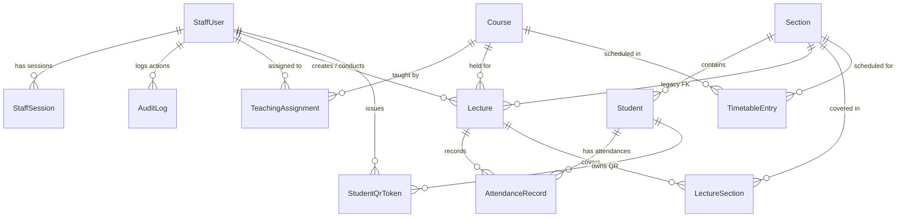

# التحليل الهندسي لقاعدة البيانات والعلاقات والترحيلات (Database & ERD)
## Attendance Recording System — Prisma ORM & PostgreSQL

---

### 1. مخطط الكيانات والعلاقات (Entity-Relationship Diagram - ERD)

تتألف قاعدة البيانات من **13 جدولاً مترابطاً** تم تصميمها بدقة لضمان تكامل البيانات، ومنع التكرار، ودعم المحاضرات متعددة الشعب، وإدارة الهيكل الأكاديمي والجدول الدراسي الأسبوعي:

---

### 2. الفهرس التفصيلي لجداول قاعدة البيانات (Database Tables Inventory)

#### 2.1 جدول المحاضرات (`Lecture`)
- **الغرض**: تسجيل جلسات المحاضرات الأكاديمية وحالتها ورموز الـ QR المتغيرة.
- **الحقول الأساسية**:
  - `id`: UUID (المفتاح الأساسي).
  - `name`: نص اسم المحاضرة (مثل "المحاضرة الأولى - الفطريات").
  - `studyPeriod`: نص نوع الدراسة (`MORNING` أو `EVENING`).
  - `section`: نص الشعبة (حقل قديم مرآتي للتوافق Legacy).
  - `sectionId`: معرف الشعبة الأولى (مفتاح أجنبي اختياري `ON DELETE SET NULL`).
  - `courseId`: معرف المادة الأكاديمية (مفتاح أجنبي `Course.id`, `ON DELETE SET NULL`).
  - `status`: حالة المحاضرة (`ACTIVE` أو `CLOSED`, افتراضياً `ACTIVE`).
  - `qrToken`: رمز الـ QR الحالي المتغير (فريد `unique`).
  - `qrExpiresAt`: تاريخ ووقت انتهاء صلاحية الرمز الصارم (المرجع النهائي للصلاحية).
  - `createdByUserId` و `conductedByUserId`: معرفات الموظف الذي أنشأ وأدار الجلسة.
  - `startedAt` و `closedAt`: طوابع بدء وإغلاق الجلسة.
  - `deletedAt`: طابع زمني للحذف المنطقي (Soft-Delete)؛ لحفظ السجلات عند أرشفة المحاضرة.
- **الفهارس**: فهارس على `courseId`, `sectionId`, `conductedByUserId`, و `deletedAt`.

#### 2.2 جدول الطلاب (`Student`)
- **الغرض**: البيانات الأساسية للطلبة وإحصائيات الحضور المتراكمة.
- **الحقول**:
  - `id`: UUID.
  - `orderIndex`: ترتيب تسلسلي اختياري في القائمة.
  - `studentCode`: الرقم الأكاديمي الفريد للفرز والباركود (مثل `S2-1001`, `unique`).
  - `name`: الاسم الثلاثي أو الرباعي للطالب.
  - `stage`: المرحلة الأكاديمية (1، 2، 3، 4 - افتراضياً 2).
  - `studyPeriod`: نوع الدراسة (`MORNING` / `EVENING`).
  - `section` و `sectionId`: اسم ومعرف شعبة الطالب (`ON DELETE SET NULL`).
  - `presentCount`, `absentCount`, `totalSessions`, `rate`: حقول مخزنة للإحصائيات التراكمية، يعاد حسابها برمجياً عبر `recomputeStudentStats`.
  - `deletedAt`: طابع زمني للحذف المنطقي.
- **الفهارس**: `@@index([stage, sectionId])`, `@@index([deletedAt])`.

#### 2.3 جدول سجلات الحضور والغياب (`AttendanceRecord`)
- **الغرض**: التوثيق الذري لكل حالة حضور أو غياب لطالب في محاضرة معينة.
- **الحقول**:
  - `id`: UUID.
  - `lectureId`: معرف المحاضرة (مفتاح أجنبي `ON DELETE CASCADE`).
  - `studentId`: معرف الطالب (مفتاح أجنبي `ON DELETE SET NULL`).
  - `studentCode` و `studentName`: كود واسم الطالب لحفظ البيانات التاريخية.
  - `status`: حالة الحضور (`PRESENT` أو `ABSENT`).
  - `registeredAt`: طابع التسجيل الزمني الدقيق.
  - `note`: ملاحظة الحضور التبادلي (مثل `حاضر عبر الشعبة 2`).
- **القيود الفريدة (Critical Constraint)**:
  - `@@unique([lectureId, studentId])`: يمنع منعاً باتاً تسجيل نفس الطالب أكثر من مرة في نفس المحاضرة تحت أي ظرف أو تسابق بيانات.

#### 2.4 جدول ربط المحاضرات بالشعب المتعددة (`LectureSection`)
- **الغرض**: تمكين المحاضرة الواحدة من تغطية عدة شعب معاً (Multi-Section Lectures).
- **الحقول**:
  - `lectureId`: مفتاح أجنبي لـ `Lecture`.
  - `sectionId`: مفتاح أجنبي لـ `Section`.
  - `@@id([lectureId, sectionId])`: مفتاح أساسي مركب يمنع تكرار ربط الشعبة بالمحاضرة.

#### 2.5 جدول الشعب الدراسية (`Section`)
- **الغرض**: تعريف الشعب الأكاديمية وتوزيعها.
- **الحقول**: `id`, `stage`, `studyPeriod`, `name`, `label`.
- **القيود**: `@@unique([stage, studyPeriod, name])` يمنع تكرار اسم الشعبة في نفس المرحلة والدراسة.

#### 2.6 جدول المواد الأكاديمية (`Course`)
- **الغرض**: تعريف المقررات الدراسية للمراحل المختلفة.
- **الحقول**: `id`, `code` (مثل `MLT201`), `name`, `stage`, `description`.
- **القيود**: `@@unique([stage, code])` يمنع تكرار رمز المادة في نفس المرحلة الأكاديمية.

#### 2.7 جدول التعيينات التدريسية (`TeachingAssignment`)
- **الغرض**: إسناد المادة للتدريسي أو الفني.
- **الحقول**: `id`, `staffUserId`, `courseId`.
- **القيود**: `@@unique([staffUserId, courseId])` لضمان عدم تكرار التعيين.

#### 2.8 جدول الجدول الدراسي الأسبوعي (`TimetableEntry`)
- **الغرض**: ضبط جدول المواعيد الأسبوعية لكل مادة وشعبة لدعم الحضور التبادلي.
- **الحقول**: `id`, `courseId`, `sectionId`, `dayOfWeek` (0=الأحد إلى 6=السبت), `startTime`, `endTime`.
- **القيود**: `@@unique([courseId, sectionId, dayOfWeek, startTime])` لمنع تضارب المواعيد للشعبة في نفس التوقيت.

#### 2.9 جداول الكادر والمستخدمين والأمان
- `StaffUser`: حسابات الموظفين، الرقم الوظيفي الفريد `staffId`, الاسم، الدور، تجزئة كلمة المرور `passwordHash`, عداد المحاولات الفاشلة، وتاريخ القفل المؤقت.
- `StaffSession`: جلسات الدخول المشفرة بتجزئة `tokenHash` (SHA-256) مع تاريخ الانتهاء والإلغاء وعنوان الـ IP.
- `AuditLog`: سجل التدقيق والمراقبة الكامل لحفظ كافة العمليات الحساسة.
- `StudentQrToken`: رموز الـ QR المصدرة لبطاقات الطلاب برمز فريد `token` وتاريخ الإلغاء.
- `SystemSetting`: جدول حفظ إعدادات النظام المفتاحية.

---

### 3. تحليل سجل الترحيلات التاريخي (Migrations History & Schema Drift)

يحتوي مجلد `apps/api/prisma/migrations/` على 7 ترحيلات رسمية:

| الترحيل (Migration) | التغييرات الهندسية التي أضافها | الحالة في الإنتاج (Production) | الحالة في التطوير (Local/Test) |
|---|---|:---:|:---:|
| `0001_init` | إنشاء الجداول الأساسية الأولى (Lecture, Student, Attendance, Staff, Session, Audit) | ✅ مطبق | ✅ مطبق |
| `0002_online_foundation` | ضبط جلسات الأونلاين وقيود التحقق والأمان | ✅ مطبق | ✅ مطبق |
| `0003_staff_management` | إضافة حقول أمان الكادر وإدارة الصلاحيات وقفل الحسابات | ✅ مطبق | ✅ مطبق |
| `0004_phase2_academics` | إضافة جداول `Section`, `Course`, `TeachingAssignment`، وإضافة أعمدة `stage`, `sectionId` للطلاب، وتحديث أكواد الطلاب لنمط `S2-` | ❌ **غير مطبق** | ✅ مطبق ومختبر |
| `0005_attendance_identity_and_lecture_archive` | استبدال قيد اسم الطالب بقيد `studentId` الفريد في الحضور، وإضافة `deletedAt` للمحاضرات | ❌ **غير مطبق** | ✅ مطبق ومختبر |
| `0006_lecture_section_identity` | إضافة المفتاح الأجنبي `Lecture.sectionId` وفهرسه وربطه مع `Section` | ❌ **غير مطبق** | ✅ مطبق ومختبر |
| `0007_multi_section_lectures_timetable` | إنشاء جدولي `LectureSection` و `TimetableEntry` وعمود `AttendanceRecord.note` | ❌ **غير مطبق** | ✅ مطبق ومختبر |

---

### 4. الفجوة المعمارية بين الإنتاج والتطوير (Production vs Dev Drift)

> [!WARNING]
> **تحذير هندسي بالغ الأهمية (Critical Finding):**
> - قاعدة بيانات الإنتاج الحقيقية (المستضافة على Railway وتحوي 297 طالباً و11 شعبة) ما تزال تقف تماماً عند الترحيل **`0003_staff_management`**.
> - الترحيلات من **`0004` إلى `0007`** لم تُطبق على الإنتاج مطلقاً، بل تم إنشاؤها واختبارها محلياً وعلى نسخ Clone تجريبية.
> - **الأثر**: لا يمكن نشر الكود المصدري الجديد (الذي يستعلم عن `courseId` أو `lectureSections` أو `sectionId`) على بيئة الإنتاج قبل تطبيق هذه الترحيلات الأربعة في نافذة صيانة رسمية، وإلا ستفشل استعلامات الـ SQL فورياً لغياب الجداول والأعمدة في الإنتاج.

