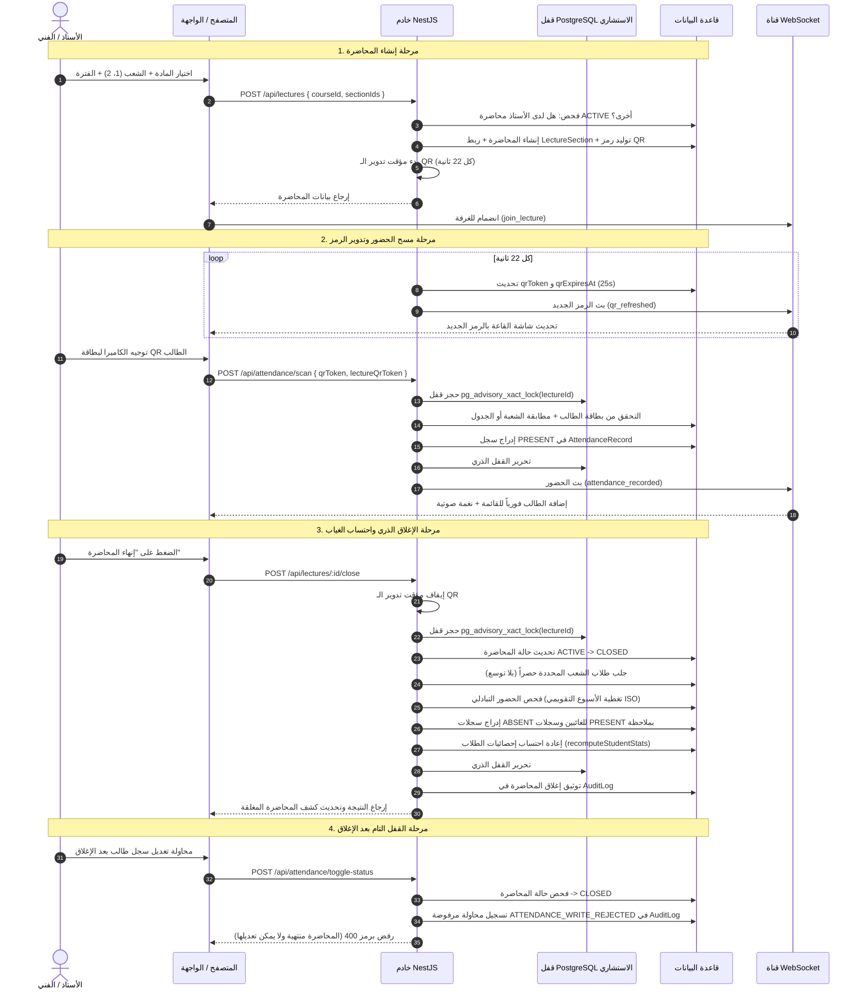

# دورة حياة المحاضرة وتسجيل الحضور (Attendance Workflow & Lifecycle)
## Attendance Recording System

---

### 1. المخطط الشامل لدورة حياة المحاضرة (Complete Lifecycle Flowchart)

---

### 2. تفكيك مراحل دورة حياة المحاضرة (Detailed Steps Analysis)

#### المرحلة الأولى: الإنشاء والتحقق من النطاق (Creation & Scoping)
1. يختار التدريسي المادة من المقررات المسندة إليه حصراً في جدول التعيينات `TeachingAssignment`. إذا حاول إرسال `courseId` لمادة غير مسندة، ترفض العملية بـ `403 Forbidden`.
2. اختيار الشعبة إلزامي؛ ويدعم النظام اختيار أكثر من شعبة معاً (`sectionIds: ['id1', 'id2']`) في حال كانت المحاضرة مشتركة في مدرج كبير.
3. يطبق الخادم حارس **"محاضرة نشطة واحدة لكل مشرف"** (`conductedByUserId == actor.id`) لمنع التدريسي من فتح عدة محاضرات في نفس اللحظة وتشتيت البيانات.
4. تُسجل المحاضرة بحالة `ACTIVE` وتُربط بالشعب في جدول `LectureSection`.

#### المرحلة الثانية: التشغيل وتدوير رموز الـ QR الحية (Live Session & Rotation)
1. بمجرد فتح المحاضرة، يُنشئ الخادم رمزاً مشفراً للـ QR مع تاريخ انتهاء بعد 25 ثانية (`qrExpiresAt`).
2. يبدأ الخادم مؤقتاً دورياً (`setInterval`) كل 22 ثانية يولد رمزاً جديداً ويحدث قاعدة البيانات، ثم يبث الرمز الجديد عبر حدث الـ WebSocket `qr_refreshed`.
3. شاشة قاعة المحاضرات تعرض الرمز وتحدثه تلقائياً دون الحاجة لتحديث الصفحة.
4. المرجع الوحيد لسلامة وصلاحية الرمز هو حقل `qrExpiresAt` في قاعدة البيانات؛ أي رمز منتهٍ يُرفض برمجياً فوراً حتى وإن ظل محفوظاً في ذاكرة العميل.

#### المرحلة الثالثة: مسح بطاقة الطالب والتحقق (Scanning & Validation)
1. يوجه الأستاذ أو الفني كاميرا الهاتف أو اللابتوب لبطاقة الطالب. تقرأ مكتبة `html5-qrcode` الرمز وترسله فورياً للـ API.
2. يتحقق الخادم أولاً من أن المحاضرة ما تزال `ACTIVE` وأن بطاقة الطالب صالحة في جدول `StudentQrToken` وليست ملغاة.
3. يطابق الخادم مرحلة وشعبة الطالب مع المحاضرة:
   - **الحالة الاعتيادية (OWN)**: الطالب ينتمي لإحدى شعب المحاضرة مباشرة -> يُقبل.
   - **حالة الحضور التبادلي (CROSS)**: الطالب من شعبة أخرى لكن المادة مجدولة لشعبته في الجدول الدراسي `TimetableEntry` -> يُقبل مع وسم السجل بملاحظة (`طالب من الشعبة X`).
   - **الرفض**: طالب من مرحلة أخرى أو دراسة مختلفة أو شعبة غير مجدولة للمادة -> يُرفض فوراً برسالة عربية صريحة.
4. يتم حجز قفل استشاري `pg_advisory_xact_lock` لحماية العملية، ويُسجل الحضور في جدول `AttendanceRecord`.
5. في حال المسح المتكرر لنفس الطالب، يمنع القيد الفريد `@@unique([lectureId, studentId])` تكرار السجل ويرجع الخادم استجابة لطيفة (`alreadyRegistered: true`) دون حدوث أخطاء.

#### المرحلة الرابعة: الإغلاق الذري واحتساب الغياب (Atomic Close)
1. عند انتهاء وقت المحاضرة، يضغط التدريسي على زر "إنهاء المحاضرة".
2. يوقف الخادم مؤقت تدوير الـ QR لحماية الرموز.
3. يدخل الخادم في معاملة قاعدة بيانات ذرية مع قفل استشاري يمنع أي مسح متزامن في تلك اللحظة.
4. تتغير حالة المحاضرة من `ACTIVE` إلى `CLOSED` وتُسجل ساعة الإغلاق `closedAt`. أي محاولة إغلاق ثانية تعيد خطأ فوري لمنع تكرار العملية.
5. يستخرج الخادم قائمة طلاب الشعب المرتبطة بالمحاضرة حصراً:
   - **حل مشكلة C1 (منع الغياب الجماعي)**: إذا كانت الشعبة جديدة أو فارغة من الطلاب، تكون النتيجة صفر طلاب، ولا يحدث أي توسع (Fallback) لطلاب المرحلة كالسابق.
6. **قاعدة التغطية الأسبوعية ("حاضر عبر الشعبة")**:
   - أي طالب في الشعبة لم يحضر المحاضرة، يفحص النظام ما إذا كان قد حضر محاضرة أخرى لنفس المادة مع شعبة زميلة خلال نفس الأسبوع التقويمي ISO، وكانت مادته مجدولة.
   - إذا ثبت حضوره المسبق في نفس الأسبوع، يُنشئ النظام له سجلاً بحالة `PRESENT` مع ملاحظة (`حاضر عبر الشعبة Y`) بدلاً من تسجيله غائباً ظلماً.
   - بقية الطلاب غير المسجلين يُنشأ لهم سجلات بحالة `ABSENT`.
7. تستدعى دالة `recomputeStudentStats` لإعادة حساب مجاميع الحضور والغياب ونسب الالتزام وتحديثها في جدول `Student`.
8. يتم توثيق العملية كاملة في جدول `AuditLog` بتفاصيل عدد الحاضرين والغائبين والمغطين.

#### المرحلة الخامسة: قفل المحاضرة المغلقة (Post-Close Immutability)
- بمجرد تحول المحاضرة إلى `CLOSED`، تصبح القراءة فقط (Read-only) قطعية.
- ترفض دالة `assertLectureWritable` في الواجهة الخلفية أي طلبات `toggle-status` أو `manual` أو `scan`، وتكتب محاولة التعديل المرفوضة في سجل التدقيق `ATTENDANCE_WRITE_REJECTED`.
- الواجهة الأمامية تخفي أزرار التبديل والتسجيل اليدوي بمجرد أن تصبح المحاضرة مغلقة.

