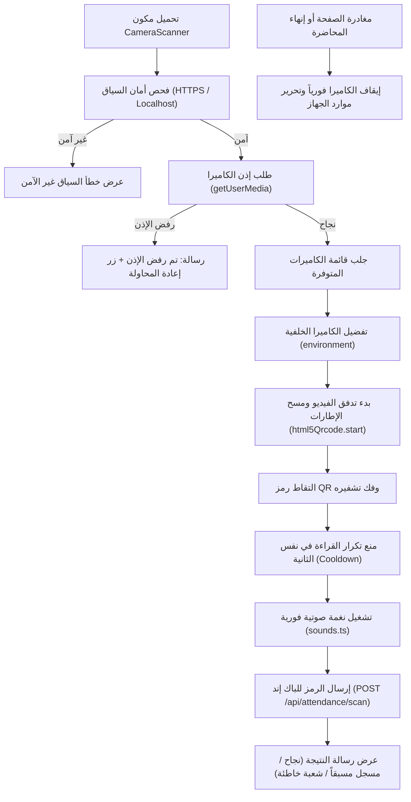

# التحليل الفني لقارئ الباركود والـ QR والكاميرا (QR Scanner & Camera)
## Attendance Recording System — html5-qrcode & Camera Integration

---

### 1. معمارية قارئ الـ QR والمكتبات المستخدمة

يعتمد النظام في مسح بطاقات الطلاب على مكتبة **`html5-qrcode` (الإصدار 2.3.8)**، وهي مكتبة متطورة تعتمد على معايير HTML5 و WebRTC القياسية للوصول إلى كاميرات الأجهزة وقراءة مختلف صيغ الباركود ثنائي الأبعاد (QR Code) دون الحاجة لتثبيت برامج وسيطة.

---

### 2. تفكيك مكون قارئ الكاميرا (`CameraScanner.tsx`)

يقع المكون في المسار: `apps/web/src/components/camera/CameraScanner.tsx`:

1. **إعدادات المسح وحجم إطار القراءة (Scanning Configuration)**:
   - معدل قراءة الإطارات: `fps: 10` لضمان سرعة الاستجابة مع تقليل استهلاك بطارية الهاتف ومعالج الحاسوب.
   - قياس مربع المسح (`qrbox`): يتم حسابه ديناميكياً بحجم 250×250 بكسل مع حد أدنى مقيد لمنع انهيار المكتبة في الشاشات الصغيرة.
   - دعم التنسيقات: محصور في `Html5QrcodeSupportedFormats.QR_CODE` لرفع سرعة المعالجة وتقليل استهلاك المعالج.
2. **التعامل مع الكاميرات المتعددة (Multi-Camera Selection)**:
   - يستعلم المكون عن جميع الكاميرات المتوفرة عبر `Html5Qrcode.getCameras()`.
   - في الهواتف الذكية، يفضل تلقائياً الكاميرا الخلفية (`facingMode: "environment"`).
   - يوفر زراً تفاعلياً لتبديل الكاميرا (Flip Camera) يتيح للأستاذ التنقل بين الكاميرات المتصلة بنقرة واحدة.
3. **تحرير الموارد والإغلاق الآمن (Lifecycle Cleanup)**:
   - يتضمن خطاف `useEffect` دالة تنظيف صارمة تستدعي `html5QrCode.stop()` عند إلغاء تحميل المكون أو مغادرة الصفحة أو الضغط على إنهاء المحاضرة.
   - هذا التنظيف يضمن إطفاء ضوء الكاميرا فورياً وتحرير العدسة لنظام التشغيل ومنع استنزاف البطارية أو انتهاك خصوصية المستخدم.

---

### 3. منظومة معالجة وترجمة أخطاء الكاميرا (`camera-errors.js`)

تم بناء وحدة معالجة أخطاء نقية ومستقلة في `apps/web/src/lib/camera-errors.js` مع تعريفات TypeScript في `camera-errors.d.ts` لتحويل أخطاء المتصفح التقنية الجافة إلى رسائل عربية واضحة تقدم حلولاً مباشرة للمستخدم:

| اسم الخطأ التقني (DOMException Name) | السبب المباشر | الرسالة المعروضة للمستخدم في الواجهة |
|---|---|---|
| `NotAllowedError` / `PermissionDeniedError` | قام المستخدم برفض إذن الكاميرا أو حظره في إعدادات المتصفح | *"تم رفض إذن الوصول إلى الكاميرا. يرجى السماح للتطبيق باستخدام الكاميرا من إعدادات المتصفح والمحاولة مجدداً."* |
| `NotFoundError` / `DevicesNotFoundError` | لا توجد أي كاميرا متصلة بالحاسوب أو الهاتف | *"لم يتم العثور على أي كاميرا متصلة بالجهاز. يرجى التأكد من توصيل الكاميرا ثم إعادة المحاولة."* |
| `NotReadableError` / `TrackStartError` | الكاميرا قيد الاستخدام بواسطة تطبيق آخر (مثل Zoom أو Teams) | *"تعذر تشغيل الكاميرا؛ قد تكون مستخدمة حالياً بواسطة تطبيق آخر. يرجى إغلاق التطبيقات الأخرى ثم إعادة المحاولة."* |
| `OverconstrainedError` | دقة التصوير أو القيود المطلوبة غير مدعومة في هذه العدسة | *"إعدادات الكاميرا المطلوبة غير مدعومة على هذا الجهاز. حاول استخدام كاميرا أخرى."* |
| `InsecureContextError` | تشغيل التطبيق عبر بروتوكول HTTP غير آمن بدلاً من HTTPS | *"المتصفح يمنع تشغيل الكاميرا عبر اتصال غير آمن (HTTP). يجب فتح النظام عبر رابط آمن (HTTPS) أو من الجهاز نفسه (localhost)."* |
| `AbortError` | تم مقاطعة عملية تشغيل الكاميرا فجأة قبل اكتمالها | *"تمت مقاطعة تشغيل الكاميرا. يرجى إعادة المحاولة."* |

---

### 4. التوافقية مع الأجهزة والمتصفحات المختلفة

1. **أجهزة iPhone ومتصفح Safari (iOS Compatibility)**:
   - معايير أمان Apple في iOS تفرض فتح الكاميرا فقط عبر سياق آمن (HTTPS حصراً، ويستثنى فقط `localhost`).
   - تتطلب أن يكون تشغيل الكاميرا ناتجاً عن تفاعل مباشر من المستخدم (User Gesture) لتفادي حظر Safari التلقائي. المكون يراعي ذلك تماماً.
2. **أجهزة Android ومتصفح Chrome**:
   - توافقية كاملة وسريعة مع إمكانية التبديل بين العدسات فائقة الاتساع والعدسات الأساسية.
3. **أجهزة الحاسوب المحمول والماسحات الضوئية الخارجية (USB Barcode Scanners)**:
   - يدعم النظام استخدام كاميرات الويب (Webcams) المتصلة بالحواسيب عبر USB.
   - يدعم قارئات الباركود المحمولة التي تعمل بنمط محاكاة لوحة المفاتيح (Keyboard Wedge)، حيث يستقبل حقل البحث اليدوي في الصفحة الرمز المدخل ويضغط Enter تلقائياً لتسجيل الطالب في أجزاء من الثانية.

---

### 5. جناح اختبارات أخطاء الكاميرا المؤتمت (`camera-errors.test.mjs`)

تم التحقق من صحة تغطية حالات أخطاء الكاميرا بالكامل عبر جناح اختبارات مخصص يعمل بمحرك `node:test` في المسار `apps/web/test/camera-errors.test.mjs`:
- يختبر 8 سيناريوهات مختلفة للأخطاء (رفض الإذن، عدم وجود كاميرا، انشغال الكاميرا، السياق غير الآمن، الأخطاء العشوائية).
- **النتيجة**: **8 من 8 اختبارات ناجحة بنسبة 100%**.

