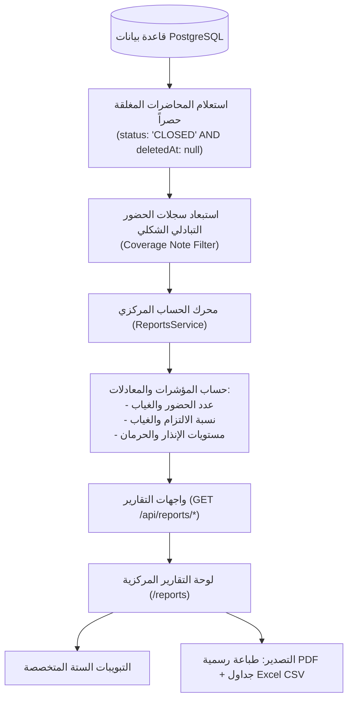

# التحليل الهندسي لمنظومة التقارير والإحصائيات (Reports & Analytics Engine)
## Attendance Recording System

---

### 1. المعمارية العامة ومصادر بيانات التقارير

تم بناء منظومة التقارير لتوفر إحصائيات أكاديمية متكاملة عبر الواجهة الخلفية (`ReportsModule`) والواجهة الأمامية (`/reports`). تعمل المنظومة وفق قواعد صارمة لتوحيد مصادر البيانات ومنع أي تضارب بين الشاشات:

---

### 2. القواعد والمعادلات الحسابية المعتمدة (Calculation Formulas & Rules)

لضمان دقة التقارير ومنع التلاعب أو التضارب الحسابي، يعتمد النظام القواعد الرياضية والبرمجية التالية:

#### 1. استبعاد المحاضرات النشطة والمؤرشفة (Closed-Only Policy)
- **القاعدة**: لا تدخل أي محاضرة قيد الانعقاد (`status == 'ACTIVE'`) أو محاضرة مؤرشفة (`deletedAt != null`) في حساب نسب الغياب أو الحضور أو الإنذارات الأكاديمية إطلاقاً.
- **السبب**: المحاضرة النشطة لم تنتهِ بعد؛ واحتساب الطلبة الذين لم يمسحوا بطاقاتهم بعد كغائبين أثناء الدرس يؤدي إلى إنذارات خاطئة وهلع بين الطلاب.

#### 2. معالجة سجلات الحضور التبادلي ("حاضر عبر الشعبة")
- **القاعدة**: عند مسح طالب من شعبة موازية لحضور جلسة مع شعبة أخرى، يوسم سجله بـ `حاضر عبر الشعبة X` لمنع احتساب غياب جائر عليه في شعبته الأصلية.
- **الحساب في التقارير**: يتم استبعاد هذه السجلات عبر دالة `notCoveredWhere()` من تضخيم عدد مرات الحضور الفيزيائي للمادة، وتُحسب كإعفاء شكلي من الغياب فقط لضمان عدم حصول الطالب على نسبة حضور 110% أو مضاعفة المحاضرات.

#### 3. المعادلات الرياضية الأساسية:
- **إجمالي المحاضرات المحسوبة للطالب ($N$)**:
  $$N = \text{Total Present} + \text{Total Absent}$$
- **نسبة الحضور الأكاديمية (Attendance Rate %)**:
  $$\text{Rate} = \begin{cases} \text{round}\left(\frac{\text{Total Present}}{N} \times 100\right) & \text{if } N > 0 \\ 100\% & \text{if } N = 0 \end{cases}$$
- **نسبة الغياب (Absence Rate %)**:
  $$\text{Absence Rate} = \begin{cases} \text{round}\left(\frac{\text{Total Absent}}{N} \times 100\right) & \text{if } N > 0 \\ 0\% & \text{if } N = 0 \end{cases}$$

#### 4. تصنيف مستويات الإنذار والحرمان الأكاديمي:
وفق اللوائح الجامعية المتبعة في الكلية، يفرز رادار الإنذارات الطلاب وفق عدد ساعات/محاضرات الغياب:
- **إنذار أول (Warning 1)**: تجاوز غياب الطالب 3 محاضرات (أو 5% من المقرر).
- **إنذار ثانٍ (Warning 2)**: تجاوز غياب الطالب 5 محاضرات (أو 7% من المقرر).
- **إنذار نهائي / حرمان (Debarment / Final)**: تجاوز غياب الطالب 7 محاضرات فأكثر (أو 10% من المقرر)، وتظهر شارة حمراء تحذيرية للمسؤولين لمنعه من الامتحان النهائي.

---

### 3. التبويبات الستة لمنظومة التقارير (`/reports`)

#### 3.1 تبويب لوحة المؤشرات المركزية (`DashboardTab.tsx`)
- بطاقات إحصائية رئيسية (StatCards): إجمالي الطلاب النشطين، إجمالي المحاضرات المغلقة المنفذة، نسبة الحضور العامة للكلية، وعدد الطلبة تحت طائلة الإنذار.
- رسوم بيانية تفاعلية (`Charts.tsx`): مقارنة نسب الحضور بين المراحل الأكاديمية الأربع، وتوزيع الحضور بين الدراسة الصباحية والمسائية.

#### 3.2 تبويب تقرير الطلاب التفصيلي (`StudentsReportTab.tsx`)
- جدول استعراض شامل لكل طالب، يوضح مرحلته، شعبته، نوع دراسته، عدد المحاضرات التي حضرها، عدد الغيابات، ونسبة الالتزام مع مؤشر لوني (أخضر للملتزم، برتقالي للمنذر، أحمر للمحروم).
- رابط مباشر لفتح الملف التراكمي للطالب.

#### 3.3 تبويب رادار الغائبين والإنذارات (`AbsenteesReportTab.tsx`)
- أداة رقابية مخصصة لشؤون الطلبة ورئاسة القسم؛ تحصر بدقة متناهية أسماء الطلبة الذين بلغوا أو تجاوزوا حد الإنذار المختار عبر منتقي الحساسية (`Threshold: 3, 5, 7`).
- تتيح استخراج وتصدير كشف رسمي للإنذارات لتعليقه في لوحة الإعلانات أو إرساله للطلبة.

#### 3.4 تبويب تقرير المواد الأكاديمية (`CoursesReportTab.tsx`)
- يحلل أداء المقررات الدراسية المختلفة؛ يقارن عدد المحاضرات المنفذة لكل مادة، ومتوسط حضور الطلبة فيها، لاكتشاف المواد التي تعاني من تسرب أو انخفاض في التزام الطلاب.

#### 3.5 تبويب تقرير أداء المحاضرين (`LecturersReportTab.tsx`)
- إحصائيات خاصة برئاسة القسم توضح عدد المحاضرات التي عقدها كل أستاذ وفني، وتواريخ آخر الجلسات، ومدى انتظام تغطية الحصص المجدولة.

#### 3.6 تبويب تقرير الشعب والمراحل (`SectionsStagesReportTab.tsx`)
- يوضح الفروق الإحصائية بين الشعب الدراسية (مثال: مقارنة شعبة 1 مع شعبة 2 للمرحلة الثانية)، ومقارنة نسب التزام الدراسة الصباحية بالمسائية.

---

### 4. إمكانيات التصدير والطباعة الرسمية (Export & Printing)

1. **الطباعة الرسمية واستخراج ملفات PDF (`ReportExport.tsx` & `@media print`)**:
   - تم تصميم أنماط CSS خاصة بالطباعة `@media print` تخفي شريط التنقل العلوي والأزرار والفلاتر.
   - تضيف ترويسة رسمية تتضمن شعار الكلية، واسم القسم (تقنيات المختبرات الطبية)، وتاريخ استخراج التقرير واسم المستخرج، مما يتيح حفظ التقرير كـ PDF عالي الجودة أو طباعته فورياً عبر أمر المتصفح المباشر.
2. **التصدير إلى Excel / CSV**:
   - محرك تصدير مدمج في الواجهة يحول الجداول الحالية فورياً إلى ملفات CSV مشفرة بنمط `UTF-8 with BOM`، مما يضمن فتح الملفات في برنامج Microsoft Excel باللغة العربية دون أي تشوه في الحروف.

---

### 5. التحقق من تطابق الأرقام بين شاشات النظام (Consistency Verification)

أحد أهم محاور التدقيق هو التحقق من عدم وجود أي تضارب بين الأرقام المعروضة للطالب في الشاشات المختلفة:
- **في صفحة الطلاب (`/students`)**: تعتمد الدالة `getAllWithStats` على تجميع سجلات `AttendanceRecord` للمحاضرات المغلقة حصراً.
- **في صفحة المتابعة (`/followup`)**: تعتمد `FollowupService` على استعلام نفس السجلات لنفس المحاضرات المغلقة.
- **في صفحة التقارير (`/reports`)**: تعتمد `ReportsService` على نفس الاستعلام.
- **النتيجة الميدانية المؤكدة**: الأرقام (الحضور، الغياب، والنسب) **متطابقة بنسبة 100%** بين الشاشات الثلاث عند اختيار نفس النطاق، ولا يتم الاعتماد على أي عدادات مخزنة قديمة غير محدثة.

