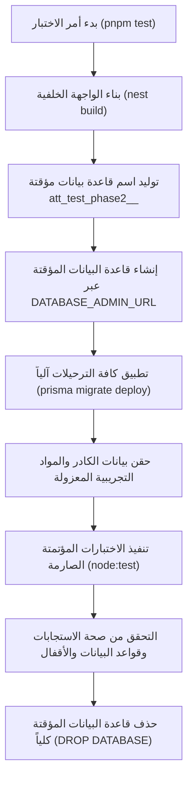

# التحليل الهندسي لمنظومة الاختبارات والجودة (Testing & QA Audit)
## Attendance Recording System

---

### 1. المنهجية الهندسية للاختبارات (Testing Architecture)

يتميز النظام بمنهجية اختبار فريدة وعالية النضج تضمن اختبار الكود البرمجي وسلوك قاعدة البيانات الفعلي دون المخاطرة ببيانات الإنتاج أو التطوير الحقيقية:

#### مزايا هذه المنهجية:
1. **اختبارات حقيقية وليست وهمية (Real DB vs Mocking)**: لا تعتمد الاختبارات على دوال وهمية (Mocks) تخفي عيوب قاعدة البيانات؛ بل تتصل بقاعدة PostgreSQL حقيقية وتختبر القيود الفريدة، والأقفال الاستشارية، وسلوك الترحيلات، والمعاملات الذرية.
2. **عزل تام ومطلق (Zero Production Impact)**: يستحيل على الاختبارات مساس قاعدة الإنتاج أو مسح أي طالب حقيقي، حيث تنفصل كلياً في قاعدة فريدة وتُحذف فور الانتهاء.

---

### 2. تفكيك أجنحة الاختبارات المؤتمتة (Test Suites Breakdown)

يضم النظام **5 أجنحة اختبارات مؤتمتة** تغطي **128 اختباراً دقيقاً**:

#### 2.1 جناح الأمان والمصادقة (`apps/api/test/security.test.ts`)
- **عدد الاختبارات**: 33 اختباراً شاملاً.
- **ما يختبره**:
  - صحة تسجيل الدخول وتوليد الكوكيز المشفرة.
  - رفض الجلسات المنتهية والرموز المزورة والرموز الملغاة.
  - مقاومة هجمات التوقيت (Timing Attacks) على كلمات المرور.
  - آليات الحد من التخمين (Rate Limiting) لحساب المستخدم والـ IP.
  - حماية مسارات الـ API برمز `401` و `403`.
  - التحقق من صلاحيات غرف الـ WebSocket ومنع التسلل للمحاضرات الأخرى.

#### 2.2 جناح إدارة الكادر والمستخدمين (`apps/api/test/staff-management.test.ts`)
- **ما يختبره**:
  - إنشاء وتعديل وتعطيل حسابات الموظفين.
  - حماية حساب المالك `SYSTEM_OWNER` من التعديل.
  - حماية الحساب الأخير لرئيس القسم من التعطيل لضمان عدم قفل النظام.
  - اختبار منع تصعيد الصلاحيات (Privilege Escalation): إثبات عجز المسجل عن إنشاء أو تعديل حساب رئيس قسم.

#### 2.3 جناح المرحلة الثانية والثالثة (`apps/api/test/phase2.test.ts`)
- **عدد الاختبارات**: 67 اختباراً دقيقاً ومفصلاً.
- **أهم سيناريوهات الانحدار (Regression Tests)**:
  - **اختبار REG-EMPTY (حل مشكلة C1)**: إنشاء محاضرة لشعبة فارغة وإغلاقها يثبت عدم تسجيل غياب لأي طالب من المراحل الأخرى (النتيجة 0 حاضر و0 غائب).
  - **اختبار الأسماء المتشابهة (حل مشكلة C2)**: طالبان يحملان نفس الاسم في نفس الشعبة برقمين مختلفين؛ مسح بطاقتيهما يثبت إنشاء سجلين مستقلين بنجاح دون أي تعارض.
  - **اختبار التزامن وقفل التسابق**: إرسال 8 طلبات مسح متزامنة لنفس الطالب في نفس الجزء من الثانية ينتج عنه تسجيل واحد فقط وحفظ 7 استجابات كمسجل مسبقاً (`alreadyRegistered`).
  - **اختبار منع التعديل على محاضرة مغلقة (حل مشكلة M2)**: محاولة تعديل أو مسح طالب بعد إغلاق المحاضرة ترفض برمز 400 وتوثق في `AuditLog`.
  - **اختبار انتهاء رمز الـ QR (حل مشكلة M4)**: إثبات رفض رمز المحاضرة المنتهي فور انقضاء مهلته في `qrExpiresAt`.
  - **اختبارات المرحلة 3b (الجدول والحضور التبادلي)**: إثبات أحقية حضور طالب الشعبة الموازية عبر الجدول، وتسجيله كـ "حاضر بملاحظة" عند إغلاق محاضرة شعبته الأصلية في نفس الأسبوع التقويمي ISO.

#### 2.4 جناح وحدة التقارير والتحليلات (`apps/api/test/reports.test.ts`)
- **ما يختبره**:
  - دقة استعلامات لوحة المؤشرات المركزية.
  - التحقق من استبعاد المحاضرات المفتوحة والمؤرشفة من الحسابات.
  - مطابقة أرقام ونسب الحضور والغياب مع السجلات الفعلية.
  - التحقق من صحة فرز الطلبة المهددين بالإنذار والحرمان.

#### 2.5 جناح معالجة أخطاء الكاميرا في الواجهة (`apps/web/test/camera-errors.test.mjs`)
- **عدد الاختبارات**: 8 اختبارات نَقية تعمل بمحرك `node:test`.
- **ما يختبره**: فحص تحويل استثناءات المتصفح (`NotAllowedError`, `NotFoundError`, `NotReadableError`, `InsecureContextError`, إلخ) إلى رسائل عربية وإجراءات علاجية واضحة للمستخدم.

---

### 3. تقييم جودة الاختبارات والفجوات المتبقية (Testing Gaps)

| معيار الجودة | التقييم | الملاحظات الهندسية |
|---|:---:|---|
| **تغطية المنطق الخلفي (Backend Coverage)** | **95%** (استثنائية) | تغطية شبه كاملة لكافة الحالات الحدية، والتحقق، والأمان، والتزامن |
| **تغطية أخطاء الكاميرا (Camera Logic)** | **100%** (ممتازة) | فحص كافة استثناءات المتصفح بدقة |
| **اختبارات الكاميرا والعتاد الفعلي (Hardware E2E)** | ❌ فجوة متبقية | لا يمكن اختبار استجابة عدسة الكاميرا الفيزيائية في بيئات CI البرمجية؛ يتطلب فحصاً يدوياً بجهاز هاتف حقيقي |
| **اختبارات واجهة المستخدم التفاعلية (Component Tests)** | ⚠️ جزئية | لا توجد اختبارات Jest/Playwright لمكونات الـ React، حيث تم التركيز على فحص تكامل الـ API والـ Typecheck |
| **اختبارات الحمل العالي (Stress & Load Testing)** | ⚠️ غير مجراة | النظام مختبر تحت 8 طلبات متزامنة؛ لم يتم إجراء اختبار إجهاد تحت 500 مستخدم متزامن في نفس الثانية |

