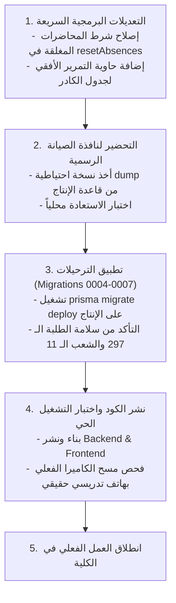

# جرد المشاكل المكتشفة والتوصيات الهندسية (Issues & Recommendations)
## Attendance Recording System — سجل الملاحظات والعيوب والحلول المقترحة

---

### 1. جدول تصنيف وحصر المشاكل الفنية (Technical Issues Registry)

تم خلال هذا التدقيق المعمق فحص كافة الملفات واكتشاف المشاكل والتناقضات الهندسية، وتم توثيقها وفق البنود الثمانية الإلزامية:

---

#### المشكلة رقم: ISS-01
1. **رقم المشكلة**: `ISS-01`
2. **مستوى الخطورة**: **حرجة جداً (Critical - Operational Risk)**
3. **مكانها**: `apps/api/prisma/migrations/` وقاعدة بيانات الإنتاج
4. **الدليل**: قاعدة بيانات الإنتاج الحقيقية تقف عند الترحيل `0003_staff_management` فقط (297 طالباً، 11 شعبة، لا يوجد جدول `Course` أو `LectureSection` أو `TimetableEntry` ولا توجد أعمدة `stage`, `sectionId` في جدول `Student`). بينما كود الفرع الحالي في الـ working tree يعتمد كلياً على الترحيلات `0004` إلى `0007`.
5. **سببها**: استمرار تطوير ميزات المرحلتين الثانية والثالثة محلياً دون تطبيق الترحيلات على الإنتاج في نافذة صيانة.
6. **تأثيرها على المستخدم**: في حال تم رفع الكود وبناء النسخة في السحاب دون ترحيل قاعدة الإنتاج، سينهار الخادم فورياً برمز 500 في كافة استعلامات المحاضرات والطلاب لغياب الجداول والأعمدة في قاعدة البيانات.
7. **الحل المقترح**: تنفيذ خطة الترحيل الرسمية (النسخ الاحتياطي الكامل، إيقاف الخوادم، تشغيل `prisma migrate deploy` لتطبيق الترحيلات 0004 إلى 0007 بالتتابع، ثم نشر الكود المحدث).
8. **هل يجب إصلاحها الآن أم لاحقاً؟**: **يجب إصلاحها فوراً وقبل أي عملية نشر للإنتاج (Must fix before launch).**

---

#### المشكلة رقم: ISS-02
1. **رقم المشكلة**: `ISS-02`
2. **مستوى الخطورة**: **عالية (High - Logic & Data Integrity Bug)**
3. **مكانها**: `apps/api/src/modules/student/student.service.ts` (الأسطر 1032–1045)
4. **الدليل**: كود دالة `resetAbsences`:
   ```typescript
   if (resetType === 'ALL_ATTENDANCE') {
     await tx.attendanceRecord.deleteMany({
       where: { studentId: { in: studentIds } },
     });
   } else {
     await tx.attendanceRecord.deleteMany({
       where: {
         studentId: { in: studentIds },
         status: 'ABSENT',
       },
     });
   }
   ```
5. **سببها**: استعلام `deleteMany` يحذف كافة سجلات الطلاب المطابقين للنطاق دون فحص حالة المحاضرة (`lecture: { status: 'CLOSED' }`).
6. **تأثيرها على المستخدم**: إذا قام المسجل بتصفير غيابات مرحلة معينة، وكان هناك تدريسي يجري محاضرة نشطة (`ACTIVE`) في نفس الدقيقة، سيتم حذف سجلات الطلاب في تلك المحاضرة المفتوحة، مما يفسد كشف الحضور الحي للأستاذ.
7. **الحل المقترح**: إضافة شرط استهداف المحاضرات المغلقة حصراً:
   ```typescript
   where: {
     studentId: { in: studentIds },
     lecture: { status: 'CLOSED' },
     ...(resetType !== 'ALL_ATTENDANCE' ? { status: 'ABSENT' } : {}),
   }
   ```
8. **هل يجب إصلاحها الآن أم لاحقاً؟**: **يجب إصلاحها الآن قبل بدء العمل الفعلي (Fix now).**

---

#### المشكلة رقم: ISS-03
1. **رقم المشكلة**: `ISS-03`
2. **مستوى الخطورة**: **متوسطة (Medium - Security Design Limitation)**
3. **مكانها**: `apps/api/prisma/schema.prisma` (النموذج `StudentQrToken` الأسطر 200–213)
4. **الدليل**: جدول `StudentQrToken` يحتوي على حقل `revokedAt` اختياري لكنه يفتقر تماماً إلى حقل تاريخ انتهاء الصلاحية `expiresAt`:
   ```prisma
   model StudentQrToken {
     id              String    @id @default(uuid())
     studentId       String
     token           String    @unique
     revokedAt       DateTime?
     createdByUserId String?
     createdAt       DateTime  @default(now())
   }
   ```
5. **سببها**: تصميم بطاقات الطلاب الأولية اعتمد على أنها رموز هوية دائمة (Opaque permanent tokens) تلغى يدوياً فقط عند فقدان البطاقة.
6. **تأثيرها على المستخدم**: إذا التقط طالب صورة لبطاقة زميله في الهاتف، ستظل البطاقة صالحة للتسجيل دائماً طوال سنوات دراسته ما لم يتم إلغاؤها يدوياً وإعادة إصدار بطاقة جديدة.
7. **الحل المقترح**: إضافة حقل `expiresAt DateTime` في جدول `StudentQrToken` وجعل صلاحية البطاقة تنتهي تلقائياً بنهاية العام الدراسي الجامعي، مع اشتراط تجديد البطاقة سنوياً.
8. **هل يجب إصلاحها الآن أم لاحقاً؟**: **يمكن تأجيلها للمرحلة القادمة أو مع انطلاق العام الدراسي الجديد (Fix later).**

---

#### المشكلة رقم: ISS-04
1. **رقم المشكلة**: `ISS-04`
2. **مستوى الخطورة**: **متوسطة (Medium - UI / Responsiveness Limitation)**
3. **مكانها**: `apps/web/src/app/staff/page.tsx` (السطر 449)
4. **الدليل**: جدول إدارة الكادر يحتوي على عرض أدنى ثابت `minWidth: '760px'` دون وجود حاوية تمرير أفقي مخصصة (`overflow-x: auto`)، ويتعارض مع سمة `overflow-x: clip` المعرفة في `globals.css` لجسم الصفحة.
5. **سببها**: استخدام تنسيق مخصص للحواسيب المكتبية دون تغليف الجدول بحاوية تمرير ناعمة للهواتف.
6. **تأثيرها على المستخدم**: عند فتح صفحة الكادر من هاتف ذكي (عرض 390px) أو تابلت عمودي (عرض 768px)، ينقص الجدول من جهة اليسار ويصعب الوصول لأزرار تفعيل وتعطيل الحسابات على الشاشات الصغيرة.
7. **الحل المقترح**: تغليف الجدول بحاوية `<div className="w-full overflow-x-auto">`.
8. **هل يجب إصلاحها الآن أم لاحقاً؟**: **تعديل بسيط ومستحسن إصلاحه قبل الاستخدام من الهواتف (Fix now / Quick fix).**

---

#### المشكلة رقم: ISS-05
1. **رقم المشكلة**: `ISS-05`
2. **مستوى الخطورة**: **منخفضة (Low - Memory / Architecture Optimization)**
3. **مكانها**: `apps/api/src/modules/auth/auth.service.ts` (السطر 64)
4. **الدليل**: عدادات محاولات الدخول الفاشلة `loginAttempts` تُدار عبر كائن جافاسكربت في الذاكرة:
   ```typescript
   private readonly loginAttempts = new Map<string, AttemptBucket>();
   ```
5. **سببها**: الرغبة في توفير حماية سريعة ضد التخمين دون إدخال مكتبات أو خوادم وسيطة إضافية مثل Redis.
6. **تأثيرها على المستخدم**: إذا أعيد تشغيل الخادم (Server Restart)، يتم تصفير عدادات الحظر فوراً؛ كما أنها لا تشارك الحالة في حال تم نشر الخادم بنمط الحاويات الموزعة المتعددة (Multi-instance Cluster).
7. **الحل المقترح**: الاعتماد على Redis أو حفظ محاولات الحظر المؤقت في جدول مخصص بقاعدة البيانات عند الانتقال للبنى السحابية الموزعة.
8. **هل يجب إصلاحها الآن أم لاحقاً؟**: **إصلاح مستقبلي عند التوسع (Fix later / Phase 4+).**

---

#### المشكلة رقم: ISS-06
1. **رقم المشكلة**: `ISS-06`
2. **مستوى الخطورة**: **منخفضة (Low - Dead Code)**
3. **مكانها**: `apps/web/src/app/attend/page.tsx`
4. **الدليل**: وجود مسار كامل لحضور الطالب بالمتصفح (`/attend`) لا يوجد أي رابط يوجه إليه في شريط التنقل `Navbar.tsx` أو في أي مكان بالتطبيق.
5. **سببها**: بقايا نموذج أولي قديم كان يفترض أن يمسح فيه الطالب رمز القاعة بنفسه، وتم استبداله بقارئ المدرس في الصفحة الرئيسية `/`.
6. **تأثيرها على المستخدم**: لا أثر ضار، لكنها تمثل كوداً زائداً غير مستخدم (Dead code).
7. **الحل المقترح**: إما أرشفة المسار أو استخدامه كصفحة تحقق عامة للطلبة مستقبلاً.
8. **هل يجب إصلاحها الآن أم لاحقاً؟**: **لا مانع من تركها أو تنظيفها لاحقاً (Low priority).**

---

### 2. خارطة طريق التحسينات والتوصيات (Actionable Recommendations)



